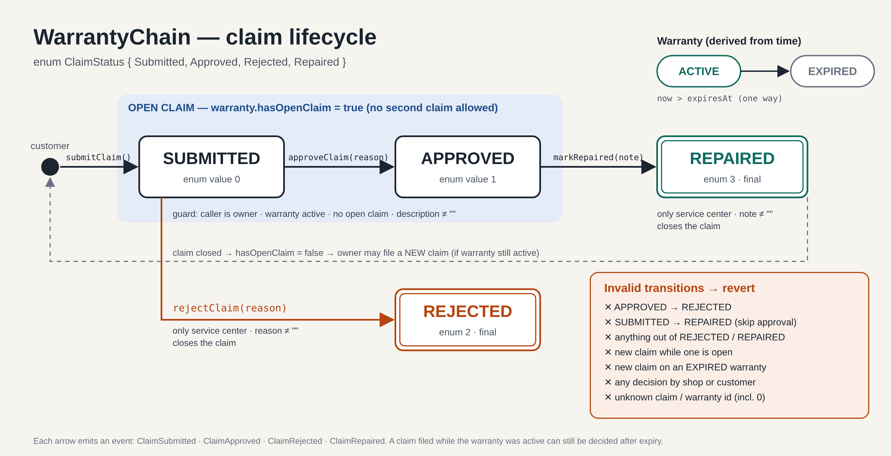

# WarrantyChain — Product Warranty Management

A course prototype where a **shop** issues digital warranties, **customers** request repairs,
and a **service center** records the result. Everything is stored on an Ethereum smart contract,
so all three parties share the same auditable history.

> Example: You buy headphones with a one-year warranty. The shop registers the warranty against
> your wallet. When the headphones break, you submit a claim. The service center checks it and
> approves or rejects it, then records the repair.

## Roles

| Role           | Can do                                                    |
| -------------- | --------------------------------------------------------- |
| Shop           | Register products, issue warranties                       |
| Customer       | View own warranties, submit repair claims                 |
| Service center | Approve / reject claims (with a reason), record repairs   |
| Anyone         | Look up a warranty and see its full history               |

There is **one shop** (the account that deploys the contract) and **one service center**
(set in the constructor). No payments and no ownership transfers, to keep it simple.

## Claim lifecycle



Project specification / presentation: https://claude.ai/artifact/1fhjoE3cGY321rRC1nxZvm

```
SUBMITTED ──► APPROVED ──► REPAIRED
    │
    └──────► REJECTED
```

Rules the contract enforces:

- Only the shop can register products and issue warranties.
- Only the service center can approve, reject, or mark a claim repaired.
- Only the warranty owner can submit a claim, and only while the warranty is **active**.
- A warranty can only have **one open claim** at a time (open = SUBMITTED or APPROVED).
- Approve/reject only works on SUBMITTED claims; "repaired" only works on APPROVED claims.
- Rejecting or repairing closes the claim, so the customer can submit a new one later.
- A serial number can only be registered once, and each product gets only one warranty.

## Tech stack

- **Solidity 0.8.24** — smart contract
- **Hardhat** — local blockchain, compile, test, deploy
- **ethers.js v6** — talking to the contract from the website
- **Plain HTML / CSS / JavaScript** — no frontend framework

## Project structure

```
contracts/WarrantyChain.sol     the smart contract
test/WarrantyChain.test.js      34 unit tests (latest run: test-results.txt)
docs/lifecycle.svg / .png       claim lifecycle state-machine diagram
scripts/deploy.js               deploys + writes frontend/contract-config.js
scripts/seed.js                 adds demo products, warranties and claims
scripts/timeTravel.js           moves blockchain time forward (to demo expiry)
frontend/index.html             the website
frontend/app.js                 website logic
frontend/style.css              styles
```

## How to run

You need Node.js 18 or newer.

```bash
npm install
```

**1. Run the tests**

```bash
npm test
```

**2. Start a local blockchain** (leave this terminal open)

```bash
npm run node
```

**3. In a second terminal, deploy and add demo data**

```bash
npm run deploy
npm run seed
```

**4. Start the website**

```bash
npm run frontend
```

Open http://localhost:8080.

### Using the website

Each tab at the top logs in with a different Hardhat test wallet (no MetaMask needed).
The role is read from the contract, so the contract decides what each account may do:

| Tab              | Hardhat account | Role           |
| ---------------- | --------------- | -------------- |
| Customer (Alice) | #2              | Customer       |
| Customer (Bob)   | #3              | Customer       |
| Shop             | #0              | Shop           |
| Service center   | #1              | Service center |

Every action opens a pop-up form. When you press **Save**, the website sends a transaction
and waits for the blockchain. If the contract refuses (for example a duplicate serial number),
its error message is shown in the pop-up.

### Demo script (about 5 minutes)

1. **Customer (Bob)** → click *History* on the Kindle: a claim that went SUBMITTED → APPROVED → REPAIRED,
   with the date and transaction hash of every step.
2. **Service center** → Alice's headphone claim is waiting. Click *Approve* and write a reason.
3. **Service center** → click *Complete repair* and write the repair notes.
4. **Customer (Alice)** → click *Request repair* on the mouse and describe the problem.
5. **Service center** → *Reject* that claim with a reason.
6. **Shop** → *+ Issue warranty* for a new product (this registers the product and then issues the warranty).
7. **Shop** → try again with the same serial number → the pop-up shows *"Serial number already registered"*.
8. In a terminal run `DAYS=40 npm run time-travel`, then open **Customer (Alice)** again → the mouse
   warranty is now **EXPIRED** and has no *Request repair* button.

If you restart `npm run node`, the blockchain is empty again — run `deploy` and `seed` again.

## Online demo (no wallet needed)

`demo/WarrantyChain-demo.html` is a single-file version of the website for sharing. It uses
`demo/demo-chain.js`, a small simulated blockchain that runs in the visitor's browser with the
same rules and error messages as the contract, so nobody needs MetaMask. Each visitor's changes
are saved only in their own browser. It is a demo, not the real blockchain.

After changing the website, rebuild it with:

```bash
npm run build-demo
```

## Deploy online (so everyone can use it)

The local version only runs on your computer. To share it you put **the contract** on the
free **Sepolia** test network and **the website** on a free static host. Online, everyone
connects their own **MetaMask** wallet (the website switches to MetaMask by itself).

| Who            | Wallet                                         |
| -------------- | ---------------------------------------------- |
| Shop           | the wallet that deploys the contract          |
| Service center | a second wallet, chosen when you deploy       |
| Customers      | anyone; the shop issues warranties to them    |

### 1. Prepare two wallets

1. Install MetaMask and create **two accounts** just for this project (Shop and Service center).
   Never use a wallet that holds real money.
2. Get free Sepolia test ETH for the **Shop** account from a faucet
   (for example the Google Cloud Web3 faucet or the Alchemy Sepolia faucet). 0.05 ETH is plenty.
   Send a little to the Service center account too, because every action costs gas.

### 2. Deploy the contract to Sepolia

Save the Shop account's private key in Hardhat's secret store (MetaMask → account → Account details →
Show private key). It is stored outside this folder, so it never gets uploaded:

```bash
npx hardhat vars set DEPLOYER_PRIVATE_KEY
```

Then deploy, using the Service center account's address:

```bash
SERVICE_CENTER=0xYourServiceCenterAddress npm run deploy:sepolia
```

This rewrites `frontend/contract-config.js` with the Sepolia address and prints an Etherscan link.

### 3. Put the website online

The `frontend` folder is a plain static website, so any static host works:

- **Netlify (easiest):** sign in at https://app.netlify.com/drop and drag the `frontend` folder onto the page.
- **GitHub Pages:** push the project to GitHub, then Settings → Pages, and publish the `frontend` folder.

Share the link. Visitors can look at all warranties without a wallet. To take part they press
**Connect MetaMask**, and the contract decides their role from their address.

### Going back to the local demo

`npm run deploy` (with `npm run node` running) rewrites `contract-config.js` for the local chain again.
Run `npm run deploy:sepolia` again before you re-upload the website.

## Why blockchain?

The shop, customer, and service center don't fully trust each other. With the contract:

- The customer can prove they have a warranty without asking the shop.
- The shop can't quietly change the expiry date after the fact.
- Every decision by the service center (and its reason) is recorded in an event with a timestamp
  and transaction hash, and nobody can delete it.

Blockchain doesn't replace the physical inspection — the service center still has to look at the
device. It only makes the *record* of what happened trustworthy.

## Known limitations (things I would add next)

- Only one shop and one service center (could use a role mapping / OpenZeppelin `AccessControl`).
- No warranty transfer when a product is resold.
- The website loads items one by one with a loop, which would be slow with thousands of items
  (a real app would use an indexer like The Graph).
- Product names and claim descriptions are stored on-chain as strings, which costs gas and is
  public. Photos/receipts would go to IPFS with only the hash on-chain.
- Expiry is checked using `block.timestamp`, which miners can shift slightly (a few seconds).
  That's fine for warranties measured in months.
